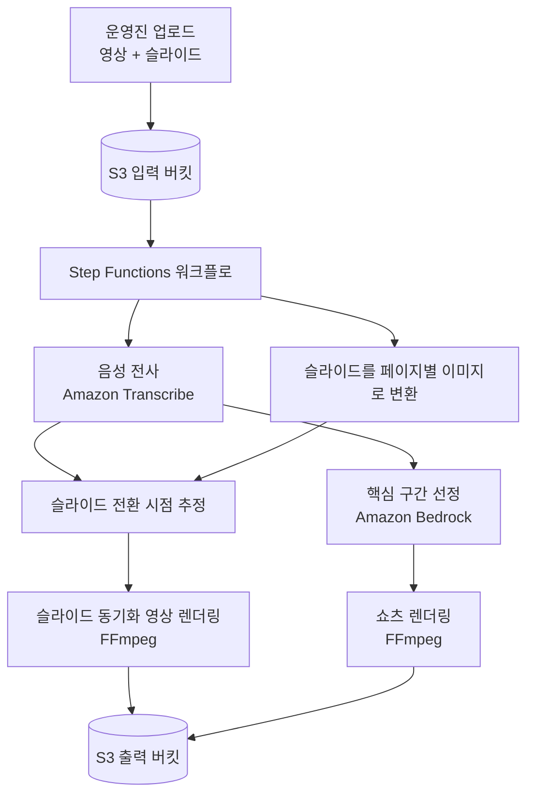

# 아키텍처 설계 초안

이 문서는 2026-11-26에 작성한 제안입니다. 여기 적힌 구성은 아직 구현하거나 시험하지 않았습니다. 처리 시간, 비용, 정확도는 실제 밋업 녹화 영상으로 측정한 뒤에 확정합니다.

## 입력과 출력

운영진이 올리는 입력은 밋업 녹화 영상 1개와 발표 슬라이드 파일 1개(PPT, PPTX 또는 PDF)입니다. 쇼츠만 만들 때는 슬라이드 파일이 없어도 됩니다.

서비스가 만드는 출력은 두 종류입니다. 첫째는 슬라이드를 중앙에, 녹화 영상을 좌측 하단에 배치한 가로(16:9) 영상입니다. 둘째는 핵심 구간을 잘라 자막을 얹은 세로(9:16) 쇼츠 여러 편입니다.

## 처리 흐름

두 기능은 음성 전사 결과를 함께 씁니다. 그래서 전사는 한 번만 실행하고 그 결과를 S3에 저장해 두 기능이 읽도록 합니다.

## 단계별 설명

**음성 전사.** Amazon Transcribe로 녹화 영상의 음성을 단어별 시각이 붙은 한국어 텍스트로 바꿉니다. 이 텍스트는 슬라이드 전환 시점 추정, 핵심 구간 선정, 쇼츠 자막의 공통 재료입니다. AWS 발표는 영어 서비스명과 한국어가 섞여 나오므로, 서비스명 인식 정확도는 실제 녹화로 확인해야 합니다. 정확도가 부족하면 Transcribe의 사용자 지정 어휘(custom vocabulary)에 AWS 서비스명을 등록하는 방법을 먼저 시험합니다.

**슬라이드 이미지 변환.** PPT와 PPTX는 LibreOffice로 PDF로 바꾸고, PDF는 페이지마다 이미지 한 장으로 바꿉니다. LibreOffice는 실행 파일이 커서 Lambda 기본 패키지에 넣기 어렵습니다. 그래서 컨테이너 이미지로 실행합니다.

**슬라이드 전환 시점 추정.** 이 단계가 기능 1의 정확도를 결정합니다. 방법은 두 가지를 검토합니다.

첫 번째 방법은 화면 대조입니다. 녹화 영상에 발표 화면이 함께 찍혀 있으면, 영상에서 일정 간격으로 뽑은 프레임과 슬라이드 이미지를 비교해 각 시점에 어느 슬라이드가 떠 있는지 찾습니다. 이 방법은 실제로 화면에 보인 것을 기준으로 하므로, 발표자가 슬라이드를 건너뛰거나 되돌아가도 따라갈 수 있습니다. 대신 녹화 영상에 슬라이드가 보여야 한다는 조건이 붙습니다.

두 번째 방법은 내용 대조입니다. 녹화 영상에 발표자만 찍혀 있으면, 각 슬라이드의 텍스트와 전사 텍스트를 Amazon Bedrock의 언어 모델에 넘겨 어느 발언 구간이 어느 슬라이드에 해당하는지 추정하게 합니다. 이 방법은 화면 정보 없이도 동작하지만, 글자가 거의 없는 슬라이드나 데모 구간에서는 틀릴 수 있습니다.

AWSKRUG 밋업 녹화가 어떤 형태로 남는지(발표 화면 포함 여부, 카메라 위치)를 먼저 확인해야 어느 방법을 기본으로 할지 정할 수 있습니다. 어느 방법이든 추정 결과를 `슬라이드 번호 - 시작 시각` 목록(JSON)으로 저장하고, 운영진이 렌더링 전에 이 목록을 고칠 수 있게 합니다. 자동 추정이 틀렸을 때 사람이 고칠 수단이 없으면 결과 영상을 쓸 수 없기 때문입니다.

**핵심 구간 선정.** 전사 텍스트를 Amazon Bedrock의 언어 모델에 넘겨, 앞뒤 맥락 없이도 이해되는 30-60초 구간을 여러 개 고르게 합니다. 모델은 각 구간의 시작 시각, 끝 시각, 제목, 선정 이유를 돌려줍니다. 구간의 시작과 끝은 전사 결과의 문장 경계에 맞춥니다. 문장 중간에서 영상이 잘리는 것을 막기 위해서입니다.

**렌더링.** FFmpeg로 영상을 합성합니다. 슬라이드 동기화 영상은 슬라이드 이미지를 전환 시점 목록에 따라 이어 붙인 배경 위에 녹화 영상을 좌측 하단에 작게 겹칩니다. 쇼츠는 선정한 구간을 잘라 9:16으로 재구성하고 자막을 입힙니다. 밋업 녹화는 1-2시간 길이라서 렌더링이 Lambda의 최대 실행 시간(15분)을 넘을 수 있습니다. 그래서 렌더링은 AWS Fargate 또는 AWS Batch의 컨테이너로 실행하는 것을 제안합니다. 실제 소요 시간은 측정이 필요합니다.

## AWS 서비스 구성 제안

| 역할 | 제안하는 서비스 | 선택 이유 |
|---|---|---|
| 파일 저장 | Amazon S3 | 수 GB 영상은 미리 서명된 URL로 브라우저에서 직접 올립니다. |
| 작업 순서 제어 | AWS Step Functions | 단계가 길고 실패 시 재시도할 단계가 명확합니다. |
| 음성 전사 | Amazon Transcribe | 단어별 시각을 제공하는 관리형 서비스입니다. |
| 언어 모델 | Amazon Bedrock | 슬라이드 내용 대조와 핵심 구간 선정에 씁니다. |
| 영상 처리 | AWS Fargate 또는 AWS Batch + FFmpeg | 실행 시간 제한이 없습니다. |
| 작업 상태 저장 | Amazon DynamoDB | 작업별 진행 상태와 결과 위치를 기록합니다. |
| 업로드 화면 | S3 + Amazon CloudFront | 정적 웹 화면으로 충분합니다. |
| 인프라 정의 | AWS CDK(TypeScript) | `infra/`에 초기화해 두었습니다. |

Bedrock에서 쓸 모델은 코드에 고정하지 않고 환경 변수로 둡니다. 핵심 구간 선정과 슬라이드 내용 대조는 긴 전사 텍스트를 읽고 판단하는 작업이므로 중간 등급 모델(Claude Sonnet 계열)에서 시작하고, 결과 품질을 본 뒤 등급을 올리거나 내리는 것을 제안합니다.

## 결정이 필요한 사항

아래 항목은 운영진의 답이 있어야 설계를 확정할 수 있습니다.

1. **녹화 형태.** 밋업 녹화 영상에 발표 화면이 함께 찍히는지, 발표자만 찍히는지에 따라 슬라이드 전환 시점 추정 방법이 달라집니다.
2. **사용자 범위와 인증.** 업로드 화면을 운영진 몇 명만 쓰는지, 소모임 운영자 전체가 쓰는지에 따라 인증 방식이 달라집니다.
3. **배포할 AWS 계정과 리전.** Bedrock에서 쓸 수 있는 모델은 리전마다 다릅니다.
4. **발표자 동의와 저작권.** 녹화 영상과 슬라이드를 마케팅 영상으로 재가공해 공개하는 데 발표자의 동의를 어떻게 받는지 정해야 합니다.
5. **쇼츠 화면 구성.** 가로 영상을 세로로 바꿀 때 발표자를 크게 보여 줄지, 슬라이드를 위에 발표자를 아래에 둘지 정해야 합니다.
6. **비용 한도.** 영상 1편당 허용하는 비용이 정해지면 렌더링 방식과 모델 등급을 그에 맞춥니다.
