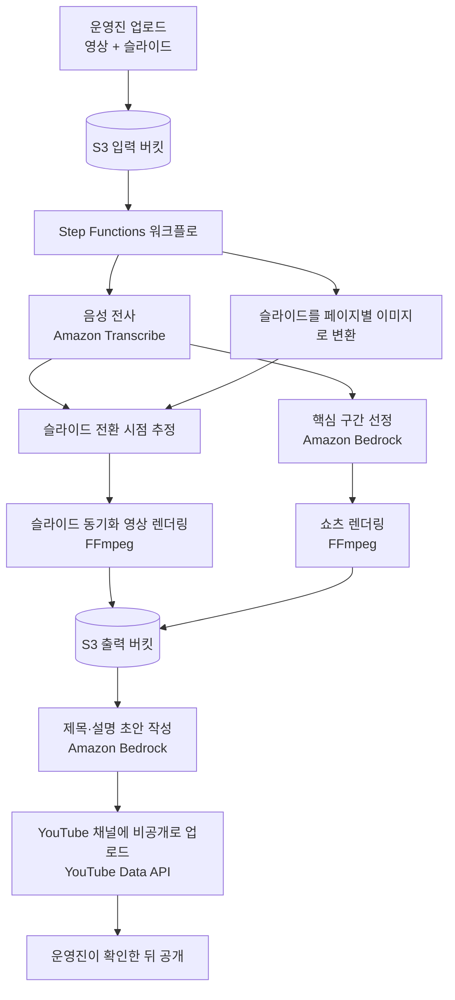

# 아키텍처 설계 초안

이 문서는 2026-11-26에 작성한 제안입니다. 여기 적힌 구성은 아직 구현하거나 시험하지 않았습니다. 처리 시간, 비용, 정확도는 실제 밋업 녹화 영상으로 측정한 뒤에 확정합니다.

## 입력과 출력

운영진이 올리는 입력은 밋업 녹화 영상 1개와 발표 슬라이드 파일 1개(PPT, PPTX 또는 PDF)입니다. 쇼츠만 만들 때는 슬라이드 파일이 없어도 됩니다.

서비스가 만드는 영상은 두 종류입니다. 첫째는 슬라이드를 중앙에, 녹화 영상을 좌측 하단에 배치한 가로(16:9) 영상입니다. 둘째는 핵심 구간을 잘라 자막을 얹은 세로(9:16) 쇼츠 여러 편입니다. 서비스는 완성한 영상을 S3에 저장하고, AWSKRUG YouTube 채널에 비공개 상태로 올립니다.

## 처리 흐름

두 기능은 음성 전사 결과를 함께 씁니다. 그래서 전사는 한 번만 실행하고 그 결과를 S3에 저장해 두 기능이 읽도록 합니다.

## 단계별 설명

**음성 전사.** Amazon Transcribe로 녹화 영상의 음성을 단어별 시각이 붙은 한국어 텍스트로 바꿉니다. 이 텍스트는 슬라이드 전환 시점 추정, 핵심 구간 선정, 쇼츠 자막의 공통 재료입니다. AWS 발표는 영어 서비스명과 한국어가 섞여 나오므로, 서비스명 인식 정확도는 실제 녹화로 확인해야 합니다. 정확도가 부족하면 Transcribe의 사용자 지정 어휘(custom vocabulary)에 AWS 서비스명을 등록하는 방법을 먼저 시험합니다.

**슬라이드 이미지 변환.** PPT와 PPTX는 LibreOffice로 PDF로 바꾸고, PDF는 페이지마다 이미지 한 장으로 바꿉니다. LibreOffice는 실행 파일이 커서 Lambda 기본 패키지에 넣기 어렵습니다. 그래서 컨테이너 이미지로 실행합니다.

**슬라이드 전환 시점 추정.** 이 단계가 기능 1의 정확도를 결정합니다. 방법은 두 가지를 검토합니다.

첫 번째 방법은 화면 대조입니다. 녹화 영상에 발표 화면이 함께 찍혀 있으면, 영상에서 일정 간격으로 뽑은 프레임과 슬라이드 이미지를 비교해 각 시점에 어느 슬라이드가 떠 있는지 찾습니다. 이 방법은 실제로 화면에 보인 것을 기준으로 하므로, 발표자가 슬라이드를 건너뛰거나 되돌아가도 따라갈 수 있습니다. 대신 녹화 영상에 슬라이드가 보여야 한다는 조건이 붙습니다.

두 번째 방법은 내용 대조입니다. 녹화 영상에 발표자만 찍혀 있으면, 각 슬라이드의 텍스트와 전사 텍스트를 Amazon Bedrock의 언어 모델에 넘겨 어느 발언 구간이 어느 슬라이드에 해당하는지 추정하게 합니다. 이 방법은 화면 정보 없이도 동작하지만, 글자가 거의 없는 슬라이드나 데모 구간에서는 틀릴 수 있습니다.

AWSKRUG 밋업 녹화가 어떤 형태로 남는지(발표 화면 포함 여부, 카메라 위치)를 먼저 확인해야 어느 방법을 기본으로 할지 정할 수 있습니다. 어느 방법이든 추정 결과를 `슬라이드 번호 - 시작 시각` 목록(JSON)으로 저장하고, 운영진이 렌더링 전에 이 목록을 고칠 수 있게 합니다. 자동 추정이 틀렸을 때 사람이 고칠 수단이 없으면 결과 영상을 쓸 수 없기 때문입니다.

**핵심 구간 선정.** 전사 텍스트를 Amazon Bedrock의 언어 모델에 넘겨, 앞뒤 맥락 없이도 이해되는 30-60초 구간을 여러 개 고르게 합니다. 모델은 각 구간의 시작 시각, 끝 시각, 제목, 선정 이유를 돌려줍니다. 구간의 시작과 끝은 전사 결과의 문장 경계에 맞춥니다. 문장 중간에서 영상이 잘리는 것을 막기 위해서입니다.

**렌더링.** FFmpeg로 영상을 합성합니다. 슬라이드 동기화 영상은 슬라이드 이미지를 전환 시점 목록에 따라 이어 붙인 배경 위에 녹화 영상을 좌측 하단에 작게 겹칩니다. 쇼츠는 선정한 구간을 잘라 9:16으로 재구성하고 자막을 입힙니다. 밋업 녹화는 1-2시간 길이라서 렌더링이 Lambda의 최대 실행 시간(15분)을 넘을 수 있습니다. 그래서 렌더링은 AWS Fargate 또는 AWS Batch의 컨테이너로 실행하는 것을 제안합니다. 실제 소요 시간은 측정이 필요합니다.

**YouTube 업로드.** 렌더링이 끝나면 서비스가 완성된 영상을 AWSKRUG YouTube 채널에 비공개 상태로 올리고, 운영진이 YouTube Studio에서 내용을 확인한 뒤 공개합니다. 자동으로 공개하지 않는 이유는 두 가지입니다. 자동으로 추정한 슬라이드 전환 시점과 자동으로 고른 쇼츠 구간이 틀릴 수 있고, 발표자가 동의하지 않은 영상이 공개되는 것을 막아야 하기 때문입니다. 영상의 제목, 설명, 태그는 전사 텍스트를 Amazon Bedrock의 언어 모델에 넘겨 초안을 만들고 업로드할 때 함께 넣습니다. 업로드의 전제 조건과 한도는 아래 "YouTube 업로드의 전제 조건"에 따로 적었습니다.

## 인증과 사용자 범위

이 서비스는 GitHub 계정으로 로그인하며, GitHub의 `awskrug` 조직(organization)에 있는 `sns-working-group` 팀의 멤버만 계정을 만들고 사용할 수 있습니다. 처음에는 조직 멤버 전체를 사용자로 정했다가, 2026-11-26에 이 팀으로 범위를 좁혔습니다. 권한 등급은 하나이며, 로그인할 수 있는 사람은 모든 기능을 쓸 수 있습니다. 아래의 구현 방식은 제안이며, GitHub API의 동작은 구현을 시작할 때 공식 문서로 다시 확인해야 합니다.

**로그인 흐름.** 사용자가 웹 화면에서 "GitHub로 로그인"을 누르면 GitHub의 승인 화면으로 이동합니다. 사용자가 승인하면 GitHub가 서비스의 콜백 주소로 인증 코드를 보냅니다. 서비스의 로그인 처리 Lambda가 이 코드를 GitHub 접근 토큰으로 바꾸고, 그 토큰으로 사용자의 GitHub 사용자 ID와 로그인 이름을 조회합니다. 그다음 이 사용자가 `sns-working-group` 팀의 멤버인지 확인합니다. 멤버이면 서비스가 자체 세션 토큰을 발급하고, 멤버가 아니면 로그인을 거부하고 계정을 만들지 않습니다.

**팀 멤버 확인 방법.** GitHub App을 만들어 `awskrug` 조직에 설치하고, 이 앱에 조직 멤버 읽기 권한을 주는 방식을 제안합니다. 로그인 처리 Lambda는 이 앱의 설치 토큰으로 GitHub REST API의 팀 멤버십 확인 엔드포인트(`GET /orgs/awskrug/teams/sns-working-group/memberships/{username}`)를 호출합니다. 이 방식을 제안하는 이유는 두 가지입니다. 첫째, 조직 멤버십을 비공개로 설정한 멤버도 확인할 수 있습니다. 사용자의 토큰으로 조회하는 방식은 사용자에게 조직 읽기 권한(`read:org`)을 추가로 요구하고, 조직이 외부 앱 접근을 제한하고 있으면 조직 소유자의 승인이 따로 필요합니다. 둘째, 사용자가 승인 화면에서 내주는 권한이 본인 식별 정보로 한정됩니다. GitHub App을 조직에 설치하려면 `awskrug` 조직 소유자의 승인이 필요합니다.

**계정 생성.** 팀 멤버가 처음 로그인하면 서비스가 DynamoDB에 사용자 레코드를 만듭니다. 레코드의 키는 GitHub 사용자 ID(숫자)로 합니다. 로그인 이름은 사용자가 바꿀 수 있지만 사용자 ID는 바뀌지 않기 때문입니다. 별도의 가입 신청이나 관리자 승인 절차는 두지 않습니다.

**멤버 자격 상실 처리.** 팀에서 빠진 사람이 계속 서비스를 쓰는 것을 막기 위해, 서비스는 로그인할 때마다 팀 멤버 여부를 다시 확인하고 세션 토큰에 만료 시간을 둡니다. 세션이 만료되면 사용자는 다시 로그인해야 하고, 그때 멤버가 아니면 거부됩니다. 세션 만료 시간이 짧을수록 자격 상실이 빨리 반영되지만 사용자가 자주 로그인해야 하므로, 만료 시간은 아래 "결정이 필요한 사항"에서 정합니다.

**API 보호.** 업로드 URL 발급, 작업 조회, 슬라이드 전환 시점 수정, YouTube 업로드 요청 등 모든 API는 Amazon API Gateway의 Lambda 권한 부여자(authorizer)가 세션 토큰을 검증한 뒤에만 실행됩니다. GitHub App의 비밀 키와 세션 토큰 서명 키는 AWS Secrets Manager에 보관합니다.

**Amazon Cognito를 쓰지 않는 이유.** Cognito 사용자 풀은 외부 로그인 제공자로 OIDC 표준을 따르는 서비스를 연결할 수 있습니다. GitHub의 로그인은 OAuth 2.0 방식이고 OIDC 표준의 ID 토큰을 제공하지 않으므로, Cognito에 연결하려면 둘 사이를 변환하는 중계 서비스를 따로 운영해야 합니다. 조직 멤버 확인도 어차피 별도 Lambda에서 해야 하므로, 로그인 처리 Lambda가 GitHub와 직접 통신하는 구성이 운영할 요소가 더 적습니다.

## YouTube 업로드의 전제 조건

이 절의 YouTube 정책은 2026-11-26에 Google 공식 문서를 조회해 확인한 내용입니다. 조회는 페이지를 요약해 주는 도구를 거쳤으므로, 구현을 시작할 때 각 항목에 붙인 원문 링크를 다시 읽어 확인해야 합니다.

**업로드 방법.** YouTube Data API v3의 [`videos.insert`](https://developers.google.com/youtube/v3/docs/videos/insert)를 호출해 영상 파일과 제목, 설명, 태그, 공개 범위를 한 번에 올립니다. 쇼츠도 같은 호출로 올립니다. YouTube 고객센터의 [Shorts 안내](https://support.google.com/youtube/answer/10059070)에 따르면 길이 3분 이하의 세로 영상은 쇼츠로 올릴 수 있습니다. 쇼츠 전용 업로드 API가 따로 없다는 문장은 공식 문서에서 찾지 못했으므로, 세로 영상을 올렸을 때 쇼츠로 분류되는지는 실제 업로드로 확인합니다.

**채널 권한 보유자의 승인.** 업로드는 OAuth 2.0 사용자 승인 방식으로 설계합니다. AWSKRUG 채널에 업로드 권한이 있는 사람이 Google 동의 화면에서 한 번 승인하면 갱신 토큰(refresh token)이 발급됩니다. 서비스는 이 갱신 토큰을 AWS Secrets Manager에 저장하고, 업로드할 때마다 꺼내 접근 토큰을 발급받습니다. 사람의 승인 없이 서비스 계정만으로 채널에 업로드하는 방법은 알려진 바로는 지원되지 않습니다. 다만 이 제약을 명시한 공식 문서 문장은 이번 조회에서 찾지 못했습니다.

**OAuth 앱의 게시 상태.** [Google OAuth 2.0 문서](https://developers.google.com/identity/protocols/oauth2)에 따르면 OAuth 동의 화면의 사용자 유형이 "외부"이고 게시 상태가 "테스트"인 앱은 갱신 토큰이 7일 뒤 만료됩니다. 토큰이 만료되면 채널 권한 보유자가 다시 승인해야 하므로 무인 업로드가 멈춥니다. 이를 피하려면 OAuth 앱의 게시 상태를 "프로덕션"으로 바꿔야 합니다. 프로덕션 전환에 Google의 앱 검증이 필요한지는 확인하지 못했습니다.

**업로드 횟수 한도.** [할당량 문서](https://developers.google.com/youtube/v3/determine_quota_cost)에 따르면 기본 한도는 하루에 `videos.insert` 100회입니다. 이 한도는 다른 API 호출의 일일 10,000 단위 한도와 별도로 계산됩니다. 밋업 1회에서 나오는 영상은 슬라이드 동기화 영상 1편과 쇼츠 몇 편이므로 기본 한도 안에 들어갑니다.

**공개 범위와 예약 공개.** [개정 이력](https://developers.google.com/youtube/v3/revision_history)에 따르면, 검증받지 않은 API 프로젝트가 올린 영상을 비공개로 고정하던 제한은 2026-11-02에 해제되었습니다. 따라서 API 준수 심사를 받지 않아도 API로 공개 영상을 올릴 수 있습니다. 예약 공개는 [`status.publishAt`](https://developers.google.com/youtube/v3/docs/videos)으로 설정하며, 영상의 공개 범위가 비공개이고 그 영상이 한 번도 공개된 적이 없을 때만 설정할 수 있습니다. 이 서비스는 비공개로 올리므로, 운영진이 확인을 마친 영상에 예약 공개 시각을 지정하는 기능을 나중에 추가할 수 있습니다.

## AWS 서비스 구성 제안

쇼츠 MVP에 대해서는 2026-11-27에 아래 제안을 구체적인 구성으로 정했습니다. API 경로, 데이터 형식, 처리 단계, CDK 구성은 [plans/2026-11-27-mvp-backend-contract.md](plans/2026-11-27-mvp-backend-contract.md)에 있고, 이 절과 내용이 다르면 그 문서가 우선합니다. 정한 내용은 세 가지입니다. 영상 처리는 AWS Batch가 아니라 AWS Fargate 작업으로 실행합니다. 렌더링 요청이 드물고 한 번에 한 작업씩 실행하면 충분해서 Batch의 대기열과 컴퓨팅 환경이 필요하지 않기 때문입니다. Fargate 작업은 NAT 게이트웨이 없이 공개 서브넷에서 공인 IP로 실행합니다. NAT 게이트웨이의 고정 비용을 피하기 위해서입니다. API는 API Gateway의 HTTP API를 쓰고, CloudFront가 웹 화면과 API를 같은 도메인으로 제공합니다. 이 구성은 `cdk synth`까지만 확인했고 배포해 검증하지 않았습니다. 배포 전에 담당자가 확인할 작업은 [plans/pending-confirmations.md](plans/pending-confirmations.md)에 있습니다.

| 역할 | 제안하는 서비스 | 선택 이유 |
|---|---|---|
| 파일 저장 | Amazon S3 | 수 GB 영상은 미리 서명된 URL로 브라우저에서 직접 올립니다. |
| 작업 순서 제어 | AWS Step Functions | 단계가 길고 실패 시 재시도할 단계가 명확합니다. |
| 음성 전사 | Amazon Transcribe | 단어별 시각을 제공하는 관리형 서비스입니다. |
| 언어 모델 | Amazon Bedrock | 슬라이드 내용 대조와 핵심 구간 선정에 씁니다. |
| 영상 처리 | AWS Fargate 또는 AWS Batch + FFmpeg | 실행 시간 제한이 없습니다. |
| YouTube 업로드 | AWS Lambda 또는 영상 처리와 같은 컨테이너 | S3의 완성 영상을 YouTube로 전송합니다. 영상 크기에 따라 Lambda의 실행 시간(최대 15분) 안에 끝나는지 측정해야 합니다. |
| 비밀 값 저장 | AWS Secrets Manager | YouTube 갱신 토큰과 OAuth 클라이언트 비밀 값, GitHub App 비밀 키, 세션 토큰 서명 키를 보관합니다. |
| 작업 상태와 사용자 저장 | Amazon DynamoDB | 작업별 진행 상태와 결과 위치, 사용자 레코드를 기록합니다. |
| 로그인과 API 보호 | Amazon API Gateway + AWS Lambda | GitHub 로그인을 처리하고 `sns-working-group` 팀 멤버 여부를 확인합니다. |
| 업로드 화면 | S3 + Amazon CloudFront | 정적 웹 화면으로 충분합니다. |
| 인프라 정의 | AWS CDK(TypeScript) | `infra/`에 초기화해 두었습니다. |

Bedrock에서 쓸 모델은 코드에 고정하지 않고 환경 변수로 둡니다. 핵심 구간 선정과 슬라이드 내용 대조는 긴 전사 텍스트를 읽고 판단하는 작업이므로 중간 등급 모델(Claude Sonnet 계열)에서 시작하고, 결과 품질을 본 뒤 등급을 올리거나 내리는 것을 제안합니다. 2026-11-27에 기본 모델을 Claude Sonnet 4.6(`global.anthropic.claude-sonnet-4-6`)으로 정했습니다. 이 계정에서는 Claude 4.7 이후 모델의 호출이 거부되기 때문입니다.

## 결정이 필요한 사항

2026-11-26 인터뷰에서 아래 항목을 정했습니다. 결정의 배경과 첫 구현 범위는 [mvp-shorts.md](mvp-shorts.md)에 있습니다.

| 항목 | 결정 |
|---|---|
| 녹화 형태 | 밋업 녹화 영상에 발표 화면이 함께 찍힙니다. 슬라이드 전환 시점 추정은 화면 대조를 기본으로 합니다. |
| 사용자 범위 | `awskrug` 조직의 `sns-working-group` 팀 멤버만 로그인할 수 있고, 권한 등급은 하나입니다. |
| AWS 계정과 리전 | 계정 `493717844238`, 리전 `ap-northeast-2`(서울). 2026-11-27에 `us-east-1`에서 변경했습니다. 이유는 [mvp-shorts.md](mvp-shorts.md)의 "리전" 문단에 있습니다. |
| 웹 주소 | `marketing.awskr.org` |
| 구현 순서 | 쇼츠 자동 생성, YouTube 비공개 업로드, 슬라이드 동기화 영상 순서로 만듭니다. |
| 쇼츠 화면 구성 | 세 가지 구성을 모두 만들어 비교한 뒤 정합니다. |
| YouTube 채널 권한 | 프로젝트 담당자가 채널 업로드 권한을 갖고 있으며 OAuth 승인을 직접 합니다. |

아래 항목은 아직 정하지 않았습니다.

1. **세션 만료 시간.** 팀에서 빠진 사람의 접근을 얼마나 빨리 막을지에 따라 정합니다.
2. **발표자 동의와 저작권.** 녹화 영상을 마케팅 영상으로 재가공해 공개하는 데 발표자의 동의를 어떻게 받는지 정해야 합니다. YouTube 업로드를 만들기 전에 정합니다.
3. **공개 절차.** 비공개로 올라간 영상을 누가 확인하고 공개하는지 정해야 합니다.
4. **Google Cloud 프로젝트.** YouTube Data API를 켤 프로젝트를 어느 Google 계정으로 만들고 관리할지 정해야 합니다.
5. **비용 한도.** 영상 1편당 허용하는 비용이 정해지면 렌더링 방식과 모델 등급을 그에 맞춥니다.
