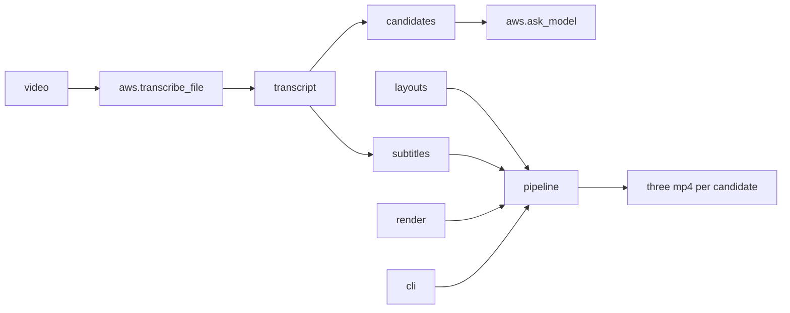
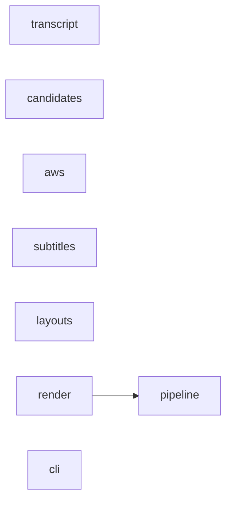

# 쇼츠 처리 코드: 설계와 구현 계획

**Goal:** 밋업 녹화 영상 1편을 로컬 명령으로 전사하고, 구간 후보를 고르고, 고른 구간을 세 가지 화면 구성의 세로(1080x1920) 쇼츠로 렌더링한다.
**Architecture:** 순수 함수 모듈(전사 해석, 후보 선정, 자막, 화면 구성) + AWS 호출 모듈 + FFmpeg 실행 모듈 + CLI. 웹 화면과 AWS 인프라는 이 계획의 범위가 아니며, 뒤에 이 모듈을 컨테이너에서 그대로 호출한다.
**Tech stack:** Python 3.12 이상, pytest, boto3, FFmpeg 7(libass, drawtext)
**Spec:** 이 문서의 1-3절, `docs/mvp-shorts.md`
**Detail:** contracts
**Target-min:** 11

## 1. 확인한 사실과 가정

2026-11-26에 AWSKRUG 채널 영상 3편의 프레임을 확인했다. DevOps 소모임 녹화(1920x1080, 39분 50초)는 객석에서 찍은 영상이고, 카메라 위치와 줌이 여러 번 바뀐다. 발표 화면과 발표자의 위치가 구간마다 다르다. Community Day 2025 영상 2편은 발표자와 슬라이드 위치가 고정된 합성 화면이다. `us-east-1`에는 `us.anthropic.claude-sonnet-5` 추론 프로필이 활성 상태다.

가정: Amazon Transcribe의 한국어 결과는 어절 단위 항목과 문장부호 항목으로 온다. 실제 결과로 확인하지 않았으며, 첫 실제 전사에서 확인한다.

## 2. 결정 (Ruling)

- Ruling: 발표 화면과 발표자 영역은 구간 후보마다 사용자가 사각형(`x,y,w,h`, 원본 픽셀)으로 지정한다 (because 밋업 영상은 구간마다 위치가 달라 영상 전체의 고정 좌표나 단순 자동 검출이 맞지 않는다). 영역을 주지 않으면 1번 구성(split)은 건너뛴다.
- Ruling: 구간 길이는 30-60초, 후보는 최대 8개 (because `docs/mvp-shorts.md`의 초안 값).
- Ruling: Bedrock 모델 ID는 환경 변수 `SHORTS_BEDROCK_MODEL_ID`, 기본값 `us.anthropic.claude-sonnet-5` (because 긴 전사문을 읽고 판단하는 작업이며 문서가 Sonnet 계열 시작을 정했다. 품질이 충분하면 Haiku로 낮춘다). 2026-11-27 수정: 이 계정에서 Sonnet 5 호출이 거부되어 기본값을 `us.anthropic.claude-sonnet-4-6`으로 바꿨다.
- Ruling: 끝 화면은 단색 배경에 로고와 문구를 놓은 2초 화면을 FFmpeg로 만든다. 로고와 글꼴 파일은 명령 인자로 받고 저장소에 넣지 않는다 (because 어느 브랜드 자산을 쓸지 정해지지 않았다).
- Ruling: 사용량 기록은 Bedrock 응답의 `totalTokens`가 입력+출력보다 크면 그 차이를 출력 토큰에 더한다 (because 추론 토큰이 출력 필드에서 빠지는 경우 비용이 과소 기록된다).
- Ruling: Detail은 contracts (because 계획 크기 상한 15k 안에 여덟 작업을 담기 위해서다).

## 3. 데이터 형식

- 단어와 문장: `{"start": float, "end": float, "text": str}` (초 단위)
- 후보: `{"start": float, "end": float, "title": str, "reason": str}`
- 영역: `(x, y, w, h)` 정수 튜플
- 화면: 1080x1920, 30fps, H.264(yuv420p) + AAC 48kHz 스테레오. 제목 띠는 위쪽 200px, 색 `0x232F3E`.

## Global constraints

- Language: Python. 패키지 루트 `services/shorts/src/shorts`, 테스트 `services/shorts/tests`.
- Test command: 저장소 루트에서 `pytest` (루트 `pytest.ini`: `pythonpath = services/shorts/src`, `testpaths = services/shorts/tests`, 마커 `slow`).
- 모듈 간 인터페이스는 dict, list, tuple, str만 쓴다. `boto3`는 `aws.make_clients` 안에서만 import한다.
- 테스트는 AWS와 네트워크를 호출하지 않는다. FFmpeg를 실행하는 테스트는 `@pytest.mark.slow`.
- 미디어 파일, 비밀 값, 계정 정보를 커밋하지 않는다.

## Main diagram



## File structure

- `pytest.ini`, `services/shorts/pyproject.toml`, `services/shorts/src/shorts/__init__.py`: 뼈대 (Wave 0)
- `transcript.py`: Transcribe JSON 해석, 문장 분리
- `candidates.py`: 프롬프트 작성, 모델 응답 해석과 검증
- `aws.py`: S3 업로드, Transcribe 작업, Bedrock 호출
- `subtitles.py`: 자막 묶음과 ASS 생성
- `layouts.py`: 세 가지 화면 구성과 장식의 FFmpeg 필터
- `render.py`: FFmpeg 명령 조립과 실행
- `pipeline.py`: 후보 하나를 세 구성으로 렌더링
- `cli.py`, `__main__.py`, `services/shorts/README.md`: 명령과 사용법

## Task graph

```mermaid
%% schedule
gantt
  title Predicted schedule (mm:ss)
  dateFormat X
  axisFormat %M:%S
  section lane 1
  T6 render :t6, 0, 143s
  T7 pipeline :t7, 143, 140s
  section lane 2
  T8 cli :t8, 0, 133s
  section lane 3
  T5 layouts :t5, 0, 106s
  section lane 4
  T3 aws :t3, 0, 105s
  section lane 5
  T2 candidates :t2, 0, 104s
  section lane 6
  T4 subtitles :t4, 0, 102s
  section lane 7
  T1 transcript :t1, 0, 98s
```





critical path: T6 → T7 (4.7 min) · peak width 7 · predicted build 4.7 min · predicted total ≈ 8.2 min (target ✓)

## Section A: text (transcript, candidates, subtitles)

**Probe entry:** call=shorts.candidates.parse_response

### T1 transcript · Complexity 3 · Est. context 26k
**Owns:** services/shorts/src/shorts/transcript.py, services/shorts/tests/test_transcript.py
**Components:** 1
**LOC owned:** 70
**Tests:** fast
**Model:** sonnet
**Produces:** transcript.parse_transcribe(data: dict) -> list[dict] · transcript.to_sentences(words: list[dict], max_gap: float = 1.0) -> list[dict] · transcript.words_between(words: list[dict], start: float, end: float) -> list[dict]
- e.g. `parse_transcribe({"results":{"items":[{"type":"pronunciation","start_time":"0.5","end_time":"0.9","alternatives":[{"content":"안녕하세요"}]},{"type":"punctuation","alternatives":[{"content":"."}]}]}}) -> [{"start":0.5,"end":0.9,"text":"안녕하세요."}]`
- e.g. `to_sentences([{"start":0.5,"end":0.9,"text":"네."},{"start":1.0,"end":1.4,"text":"좋습니다"},{"start":1.5,"end":2.0,"text":"감사합니다."}]) -> [{"start":0.5,"end":0.9,"text":"네."},{"start":1.0,"end":2.0,"text":"좋습니다 감사합니다."}]`
- e.g. `words_between([{"start":1.0,"end":2.0,"text":"a"},{"start":3.0,"end":4.0,"text":"b"}], 2.5, 5.0) -> [{"start":3.0,"end":4.0,"text":"b"}]`
**Contract:** 문장부호 항목은 앞 단어의 text에 붙인다. 앞 단어가 없으면 버린다. 문장은 `.`, `?`, `!`로 끝나는 단어 뒤, 또는 다음 단어와의 간격이 `max_gap`보다 클 때 끊는다. `words_between`은 `start <= w.start`이고 `w.end <= end`인 단어만 돌려준다.
**Review Focus:** `test_leading_punctuation_dropped`: 첫 항목이 문장부호면 결과 `[]`; `test_gap_splits_sentence`: 간격 1.5초, 문장부호 없음 → 문장 2개; `test_empty_items`: `{"results":{"items":[]}}` → `[]`; `test_missing_results_raises`: `{}` → `ValueError`
**Test code:** 위 e.g. 3건과 Review Focus 4건을 이름 그대로 작성한다.
**Steps:** 1 failing test, 2 run: FAIL, 3 implement, 4 run: PASS

### T2 candidates · Complexity 5 · Est. context 29k
**Owns:** services/shorts/src/shorts/candidates.py, services/shorts/tests/test_candidates.py
**Components:** 1
**LOC owned:** 110
**Tests:** fast
**Model:** sonnet
**Produces:** candidates.build_prompt(sentences: list[dict], count: int = 8, min_sec: int = 30, max_sec: int = 60) -> str · candidates.parse_response(text: str, sentences: list[dict], min_sec: float = 30, max_sec: float = 60) -> list[dict]
- e.g. `parse_response('[{"start_index":0,"end_index":1,"title":"T","reason":"R"}]', [{"start":0.0,"end":20.0,"text":"a"},{"start":20.0,"end":40.0,"text":"b"}]) -> [{"start":0.0,"end":40.0,"title":"T","reason":"R"}]`
- e.g. `parse_response('[]', []) -> []`
**Contract:** `build_prompt`는 문장을 `[번호] 시작-끝 텍스트` 줄로 나열하고, 앞뒤 맥락 없이 이해되는 `min_sec`-`max_sec`초 구간을 최대 `count`개, JSON 배열(`start_index`, `end_index`, `title`, `reason`)만 출력하라고 한국어로 지시한다. `parse_response`는 text에서 첫 `[`부터 마지막 `]`까지를 JSON으로 읽는다(코드 펜스와 앞뒤 설명 허용). 배열이 없거나 JSON이 아니면 `ValueError`. 항목은 다음 경우 버린다: dict가 아님, 번호가 정수가 아니거나 범위 밖, `start_index > end_index`, 길이가 `[min_sec, max_sec]` 밖, 이미 받아들인 후보와 시간이 겹침. `title`은 40자로 자른다.
**Review Focus:** `test_fenced_json`: "```json\n[...]\n```" 해석; `test_no_array_raises`: `"없음"` → `ValueError`; `test_out_of_range_dropped`: `end_index` 99 → 버림; `test_too_short_dropped`: 길이 10초 → 버림; `test_overlap_dropped`: 0-40초와 20-60초 → 첫 후보만; `test_bool_index_dropped`: `start_index` true → 버림; `test_title_truncated`: 50자 → 40자; `test_prompt_lists_sentences`: 프롬프트에 `[0] 0.0-20.0 a` 포함
**Test code:** 위 e.g.와 Review Focus를 이름 그대로 작성한다.
**Steps:** 1 failing test, 2 run: FAIL, 3 implement, 4 run: PASS

### T4 subtitles · Complexity 4 · Est. context 28k
**Owns:** services/shorts/src/shorts/subtitles.py, services/shorts/tests/test_subtitles.py
**Components:** 1
**LOC owned:** 100
**Tests:** fast
**Model:** sonnet
**Produces:** subtitles.build_cues(words: list[dict], clip_start: float, max_chars: int = 16) -> list[dict] · subtitles.build_ass(cues: list[dict], font: str = "Pretendard", font_size: int = 64, margin_v: int = 420) -> str
- e.g. `build_cues([{"start":10.0,"end":10.4,"text":"안녕하세요."},{"start":10.5,"end":11.0,"text":"반갑습니다."}], 10.0) -> [{"start":0.0,"end":0.5,"text":"안녕하세요."},{"start":0.5,"end":1.0,"text":"반갑습니다."}]`
- e.g. `build_ass([]) ->` `[Script Info]`로 시작하고 `PlayResX: 1080`, `PlayResY: 1920`을 포함하며 `Dialogue:` 줄이 없는 문자열
**Contract:** 단어를 공백으로 이어 `max_chars` 이하로 묶는다. 한 단어가 `max_chars`보다 길면 그 단어만으로 자막 한 개. `.`, `?`, `!`로 끝난 단어 뒤에서 끊는다. 시각은 `clip_start`를 뺀 값이고 0 미만은 0. 다음 자막과의 간격이 0.3초 미만이면 끝 시각을 다음 시작 시각으로 늘린다. ASS 시각 형식은 `H:MM:SS.cc`. 텍스트의 `{`, `}`는 `\{`, `\}`로, 줄바꿈은 공백으로 바꾼다. 스타일: 흰 글자, 검은 외곽선 4, 아래 가운데 정렬(Alignment 2), `MarginV`는 `margin_v`.
**Review Focus:** `test_long_word_own_cue`: 20자 단어 → 자막 1개; `test_negative_time_clamped`: 단어 시작 9.8, `clip_start` 10.0 → 0.0; `test_time_format`: 3661.5초 → `1:01:01.50`; `test_braces_escaped`: `{a}` → `\{a\}`; `test_max_chars_boundary`: 합쳐서 정확히 16자 → 자막 1개, 17자 → 2개
**Test code:** 위 e.g.와 Review Focus를 이름 그대로 작성한다.
**Steps:** 1 failing test, 2 run: FAIL, 3 implement, 4 run: PASS

## Section B: aws

**Probe entry:** call=shorts.aws.ask_model

### T3 aws · Complexity 5 · Est. context 30k
**Owns:** services/shorts/src/shorts/aws.py, services/shorts/tests/test_aws.py
**Components:** 1
**LOC owned:** 120
**Tests:** fast
**Model:** sonnet
**Produces:** aws.make_clients(profile: str | None, region: str) -> dict · aws.transcribe_file(media_path: str, bucket: str, job_name: str, s3, transcribe, poll_sec: float = 10, timeout_sec: float = 3600) -> dict · aws.ask_model(prompt: str, model_id: str, bedrock, max_tokens: int = 4096) -> dict
- e.g. `ask_model("hi", "m", fake) -> {"text":"hello","input_tokens":10,"output_tokens":5}` (fake.converse가 `{"output":{"message":{"content":[{"text":"hello"}]}},"usage":{"inputTokens":10,"outputTokens":5,"totalTokens":15}}`를 돌려줄 때)
- e.g. `make_clients(None, "us-east-1") -> {"s3": ..., "transcribe": ..., "bedrock": ...}` (`bedrock`은 `bedrock-runtime` 클라이언트)
**Contract:** `transcribe_file`은 파일을 `s3://{bucket}/input/{job_name}/{파일명}`에 올리고, `start_transcription_job`(`LanguageCode="ko-KR"`, `OutputBucketName=bucket`, `OutputKey="transcripts/{job_name}.json"`)을 호출한 뒤 `get_transcription_job`을 `poll_sec`마다 조회한다. `COMPLETED`면 `get_object`로 결과 JSON을 읽어 dict로 돌려준다. `FAILED`면 `FailureReason`을 담은 `RuntimeError`, `timeout_sec`을 넘으면 `TimeoutError`. `ask_model`은 `bedrock.converse`를 호출하고 text 블록을 이어 붙인다. `totalTokens`가 입력+출력보다 크면 차이를 `output_tokens`에 더한다. 테스트는 가짜 클라이언트 객체를 넘기고 `poll_sec=0`을 쓴다.
**Review Focus:** `test_reasoning_tokens_added`: usage 10/5/total 40 → `output_tokens` 30; `test_failed_job_raises`: `FAILED`, 사유 "bad media" → `RuntimeError`에 "bad media" 포함; `test_timeout`: 계속 `IN_PROGRESS`, `timeout_sec=0` → `TimeoutError`; `test_upload_key`: `/tmp/a b.mp4`, job `j1` → 키 `input/j1/a b.mp4`; `test_multiple_text_blocks_joined`: 블록 "a","b" → "ab"
**Test code:** 위 e.g.와 Review Focus를 이름 그대로 작성한다.
**Steps:** 1 failing test, 2 run: FAIL, 3 implement, 4 run: PASS

## Section C: video (layouts, render, pipeline, cli)

**Probe entry:** run=python -m shorts

### T5 layouts · Complexity 6 · Est. context 31k
**Owns:** services/shorts/src/shorts/layouts.py, services/shorts/tests/test_layouts.py
**Components:** 1
**LOC owned:** 130
**Tests:** fast
**Model:** sonnet
**Produces:** layouts.build_filter(layout: str, src_w: int, src_h: int, slide: tuple | None = None, speaker: tuple | None = None) -> str · layouts.decorate(title_file: str, ass_file: str, font_file: str, logo: bool) -> str
- e.g. `build_filter("crop", 1920, 1080) -> "[0:v]crop=608:1080:656:0,scale=1080:1920,setsar=1[base]"`
- e.g. `decorate("/t/title.txt", "/t/sub.ass", "/f/P.ttf", False)` → `[base]`로 시작하고 `[vout]`으로 끝나며 `drawbox`, `drawtext`, `ass=`를 포함하는 문자열
**Contract:** `build_filter`는 `[0:v]`에서 시작해 1080x1920의 `[base]`로 끝나는 필터를 만든다. `crop`: 가운데를 9:16으로 자른다(폭은 짝수로 내림). `blur`: 화면을 덮도록 확대해 자르고 `boxblur=20:5`를 건 배경 위에 폭 1080으로 줄인 원본을 가운데 겹친다. `split`: 위 200px는 검정, `slide` 영역은 y=200의 1080x860 칸에, `speaker` 영역은 y=1060의 1080x860 칸에 비율을 유지해 맞추고 남는 곳은 검정으로 채운다. 오류는 `ValueError`: 모르는 구성 이름, `split`인데 영역이 없음, 영역이 원본 밖이거나 폭·높이가 0 이하. `decorate`는 `[base]`에 제목 띠(`drawbox` 0,0,1080,200, 색 `0x232F3E`), 제목(`drawtext`, `textfile`, 흰색, 띠 가운데), 자막(`ass=`)을 얹고, `logo`가 참이면 `[1:v]`를 폭 160으로 줄여 오른쪽 아래 40px 안쪽에 겹친 뒤 `[vout]`으로 끝낸다. 경로 안의 `\`, `:`, `'`는 필터 문법에 맞게 이스케이프한다.
**Review Focus:** `test_unknown_layout`: `"x"` → `ValueError`; `test_split_requires_regions`: 영역 없음 → `ValueError`; `test_region_out_of_bounds`: `(1800,0,400,300)` on 1920x1080 → `ValueError`; `test_crop_odd_width`: 1280x720 → crop 폭 404; `test_path_colon_escaped`: `C:/a.ass` → `C\:/a.ass` 포함; `test_logo_overlay`: `logo=True` → `[1:v]`와 `overlay` 포함
**Test code:** 위 e.g.와 Review Focus를 이름 그대로 작성한다.
**Steps:** 1 failing test, 2 run: FAIL, 3 implement, 4 run: PASS

### T6 render · Complexity 5 · Est. context 31k
**Owns:** services/shorts/src/shorts/render.py, services/shorts/tests/test_render.py
**Components:** 1
**LOC owned:** 130
**Tests:** slow
**Model:** sonnet
**Produces:** render.clip_command(src: str, start: float, end: float, filter_complex: str, out: str, logo: str | None = None) -> list[str] · render.endcard_command(logo: str | None, text: str, font_file: str, out: str, seconds: float = 2.0) -> list[str] · render.concat_command(parts: list[str], out: str) -> list[str] · render.run(cmd: list[str]) -> None · render.probe(path: str) -> dict
- e.g. `probe("a.mp4") -> {"width":1080,"height":1920,"duration":2.0}`
- e.g. `clip_command("a.mp4", 1.0, 3.0, "[0:v]null[vout]", "o.mp4")` → `["ffmpeg","-y","-ss","1.0","-to","3.0","-i","a.mp4","-filter_complex","[0:v]null[vout]","-map","[vout]","-map","0:a?", ...,"o.mp4"]`
**Contract:** 출력은 30fps, `libx264`(crf 20, yuv420p), AAC 160k 48kHz 스테레오, `+faststart`. `logo`가 있으면 두 번째 입력으로 넣는다. `endcard_command`는 `0x232F3E` 단색 1080x1920 배경에 로고(있으면)를 가운데, 문구를 그 아래에 놓고 무음 오디오를 붙인다. `concat_command`는 concat 필터로 다시 인코딩한다. `run`은 종료 코드가 0이 아니면 stderr 마지막 20줄을 담은 `RuntimeError`. `probe`는 `ffprobe`로 폭, 높이, 길이를 읽는다.
**Review Focus:** `test_run_failure_raises`: `["ffmpeg","-i","/nonexistent"]` → `RuntimeError`; `test_end_before_start`: `clip_command(..., 3.0, 1.0, ...)` → `ValueError`; `test_concat_empty`: `[]` → `ValueError`; `test_clip_renders` (slow): 3초 320x180 `testsrc`+`sine` 입력, 0.5-2.5, 필터 `[0:v]scale=1080:1920[vout]` → 1080x1920, 길이 2.0±0.2; `test_endcard_and_concat` (slow): 끝 화면 1초를 이어 붙임 → 길이 3.0±0.3
**Test code:** 위 e.g.와 Review Focus를 이름 그대로 작성한다. 느린 테스트는 `tmp_path`에 입력을 만들고 글꼴은 환경 변수 `SHORTS_FONT_FILE`이 없으면 건너뛴다.
**Steps:** 1 failing test, 2 run: FAIL, 3 implement, 4 run: PASS

### T7 pipeline · Complexity 5 · Est. context 30k
**Owns:** services/shorts/src/shorts/pipeline.py, services/shorts/tests/test_pipeline.py
**Components:** 1
**LOC owned:** 110
**Tests:** slow
**Model:** sonnet
**Consumes:** transcript.words_between(words: list[dict], start: float, end: float) -> list[dict] (T1) · subtitles.build_cues(words: list[dict], clip_start: float, max_chars: int = 16) -> list[dict] (T4) · subtitles.build_ass(cues: list[dict], font: str = "Pretendard", font_size: int = 64, margin_v: int = 420) -> str (T4) · layouts.build_filter(layout: str, src_w: int, src_h: int, slide: tuple | None = None, speaker: tuple | None = None) -> str (T5) · layouts.decorate(title_file: str, ass_file: str, font_file: str, logo: bool) -> str (T5) · render.clip_command(src: str, start: float, end: float, filter_complex: str, out: str, logo: str | None = None) -> list[str] (T6) · render.endcard_command(logo: str | None, text: str, font_file: str, out: str, seconds: float = 2.0) -> list[str] (T6) · render.concat_command(parts: list[str], out: str) -> list[str] (T6) · render.run(cmd: list[str]) -> None (T6) · render.probe(path: str) -> dict (T6)
**Produces:** pipeline.render_candidate(src: str, words: list[dict], candidate: dict, out_dir: str, font_file: str, logo: str | None = None, slide: tuple | None = None, speaker: tuple | None = None, endcard_text: str = "AWSKRUG") -> list[str]
- e.g. `render_candidate("v.mp4", words, {"start":0.5,"end":2.5,"title":"제목","reason":"r"}, "out", "/f/P.ttf") -> ["out/clip-0000.5-blur.mp4","out/clip-0000.5-crop.mp4"]`
- e.g. 같은 호출에 `slide=(0,0,160,90), speaker=(160,90,160,90)` 추가 → 위 두 경로 앞에 `"out/clip-0000.5-split.mp4"`
**Contract:** 구성 순서는 `split`, `blur`, `crop`. `slide`와 `speaker`가 둘 다 있어야 `split`을 만든다. 구성마다 제목 파일과 ASS 파일을 `out_dir`의 임시 폴더에 쓰고, 본편을 렌더링하고, 끝 화면을 한 번 만들어 이어 붙인다. 파일 이름은 `clip-{시작 초, 소수 1자리, 6자리 0 채움}-{구성}.mp4`. 임시 파일은 끝나면 지운다.
**Review Focus:** `test_three_layouts` (slow): 3초 320x180 합성 입력 → 파일 3개, 각 1080x1920, 길이 2.0+2.0±0.4; `test_split_skipped_without_regions` (slow): 파일 2개; `test_title_with_quote_and_colon` (slow): 제목 `"It's 3:1"` → 렌더링 성공; `test_temp_cleaned` (slow): `out_dir`에 mp4만 남음
**Test code:** Review Focus를 이름 그대로 작성한다. `SHORTS_FONT_FILE`이 없으면 건너뛴다.
**Steps:** 1 failing test, 2 run: FAIL, 3 implement, 4 run: PASS

### T8 cli · Complexity 4 · Est. context 32k
**Owns:** services/shorts/src/shorts/cli.py, services/shorts/src/shorts/__main__.py, services/shorts/tests/test_cli.py, services/shorts/README.md, services/shorts/pyproject.toml, services/shorts/tests/conftest.py
**Components:** 2
**LOC owned:** 150
**Tests:** fast
**Model:** sonnet
**Consumes:** aws.make_clients(profile: str | None, region: str) -> dict (T3) · aws.transcribe_file(media_path: str, bucket: str, job_name: str, s3, transcribe, poll_sec: float = 10, timeout_sec: float = 3600) -> dict (T3) · aws.ask_model(prompt: str, model_id: str, bedrock, max_tokens: int = 4096) -> dict (T3) · transcript.parse_transcribe(data: dict) -> list[dict] (T1) · transcript.to_sentences(words: list[dict], max_gap: float = 1.0) -> list[dict] (T1) · candidates.build_prompt(sentences: list[dict], count: int = 8, min_sec: int = 30, max_sec: int = 60) -> str (T2) · candidates.parse_response(text: str, sentences: list[dict], min_sec: float = 30, max_sec: float = 60) -> list[dict] (T2) · pipeline.render_candidate(src: str, words: list[dict], candidate: dict, out_dir: str, font_file: str, logo: str | None = None, slide: tuple | None = None, speaker: tuple | None = None, endcard_text: str = "AWSKRUG") -> list[str] (T7) · render.run(cmd: list[str]) -> None (T6)
**Produces:** cli.main(argv: list[str] | None = None) -> int
**Contract:** 하위 명령 네 개. `transcribe VIDEO --bucket B --out FILE [--job-name N]`은 Transcribe 결과 JSON을 저장한다. `candidates TRANSCRIPT --out FILE [--count 8]`은 `{"model_id","usage":{"input_tokens","output_tokens"},"candidates":[...]}`를 저장한다. `frame VIDEO --at SEC --out PNG`는 영역을 정할 때 볼 프레임 한 장을 뽑는다. `render VIDEO TRANSCRIPT CANDIDATES --index N --out-dir DIR [--slide x,y,w,h --speaker x,y,w,h --logo PNG]`는 결과 경로를 한 줄씩 출력한다. 공통 옵션은 `--profile`, `--region`(기본 `us-east-1`). 모델 ID는 `SHORTS_BEDROCK_MODEL_ID`(기본 `us.anthropic.claude-sonnet-5`), 글꼴은 `--font-file` 또는 `SHORTS_FONT_FILE`. 오류는 stderr에 한 줄로 쓰고 2를 돌려준다. 테스트는 다른 모듈 함수를 `monkeypatch`로 바꾼다. README는 네 명령의 사용 예와 필요한 도구(FFmpeg, 글꼴, AWS 프로필)를 설명한다.
**Review Focus:** `test_rect_parse`: `--slide 10,20,300,200` → `(10,20,300,200)`; `test_rect_bad`: `--slide 1,2,3` → 종료 코드 2; `test_index_out_of_range`: 후보 2개에 `--index 5` → 2; `test_candidates_writes_usage`: 가짜 `ask_model` → 파일에 `usage`와 `model_id`; `test_model_env_override`: 환경 변수 값이 `ask_model`에 전달됨; `test_missing_font`: 글꼴 없음 → 2
**Test code:** Review Focus를 이름 그대로 작성한다.
**Steps:** 1 failing test, 2 run: FAIL, 3 implement, 4 run: PASS

## Review Focus

- Section A (library): numeric(시각 경계, 길이 한계), encoding(한글, 중괄호, 코드 펜스), deep(잘못된 모델 응답).
- Section B (data pipeline): state(작업 상태 전이, 시간 초과), numeric(토큰 합산).
- Section C (file generator, CLI): file(경로 이스케이프, 임시 파일 정리), protocol(명령 인자), encoding(제목의 특수 문자).

## Self-review

모든 Consumes는 같은 서명의 Produces가 있다. 간선은 T7의 테스트가 실제로 실행하는 T4, T5, T6뿐이다. 동시에 실행되는 작업이 같은 파일을 갖지 않는다. 실제 AWS 호출(전사, 후보 선정)은 이 계획의 테스트에 없으며, 구현 뒤 사용자 확인을 받고 따로 실행한다.
